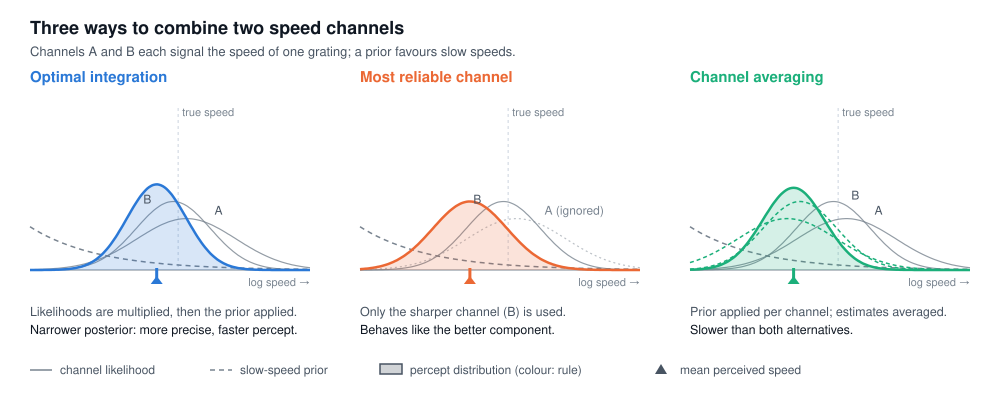

# signal-integration

Interactive companion to

> M. Jogan and A. A. Stocker (2015). **Signal integration in human visual speed perception.**
> *Journal of Neuroscience* 35(25):9381–9390. doi:[10.1523/JNEUROSCI.4801-14.2015](https://doi.org/10.1523/JNEUROSCI.4801-14.2015)

**▶ [See the illusions](https://matjazjogan.github.io/signal-integration/)**

A moving object excites many spatiotemporal frequency channels at once, yet we perceive a single speed. In this study we asked how the visual system combines these signals. We measured speed discrimination for stimuli that each targeted a single channel, fitted a Bayesian observer with a prior for slow speeds, and predicted perception of stimuli that drive several channels at once. Only an observer that integrates the channel likelihoods optimally, before applying the prior, accounted for the data; observers that rely on the most reliable channel or average per-channel estimates did not.

## Demonstrations

`index.html` is a single self-contained page with two short demonstrations that perceived speed is not veridical. In each, one grating drifts at a constant 2°/s for about four seconds and something other than its speed changes halfway through; the viewer reports whether it sped up or slowed down.

| Demonstration | Change | Usually seen | Why |
| --- | --- | --- | --- |
| Contrast | 1 c/° grating, contrast 40% → 4% | slows down | a less reliable measurement is drawn further towards the slow-speed prior |
| A second spatial frequency | 0.5 c/° grating at 6%, then 2 c/° at 10% added | speeds up | optimal integration makes the combined measurement more reliable, so the prior pulls less |

*Play reversed* runs each change the other way round, which reverses the illusion. Averaging the per-channel estimates would predict the opposite of the second effect, a compound grating that appears slower than the coarse one alone. Gratings are band-limited noise (bandwidth 0.04 ωs, as in the study) in a 5° raised-cosine window, rendered with random dithering; contrast and speed are nominal, as the display is not calibrated.

## Model

Speed is represented as s = log(1 + v/0.3). Each channel contributes a Gaussian likelihood of width σX, and the prior is locally log p(s) = as + b, with a < 0 favouring slow speeds. For a stimulus that drives several channels the three observers predict

| Model | Mean of percept | Variance of percept |
| --- | --- | --- |
| Optimal integration | s + aσ², with 1/σ² = Σ 1/σX² | σ² |
| Most reliable channel | s + aσmin² | σmin² |
| Channel averaging | s + (a/k) Σ σX² | Σ σX² / k² |

A correction to the paper: in Fig. 3b the SD of the balanced psychometric function should read √2·σTest, not σTest/√2, as the Methods (σ = 0.6/√2) and Fig. 3c imply.

The page is served by GitHub Pages from the root of the `main` branch.
